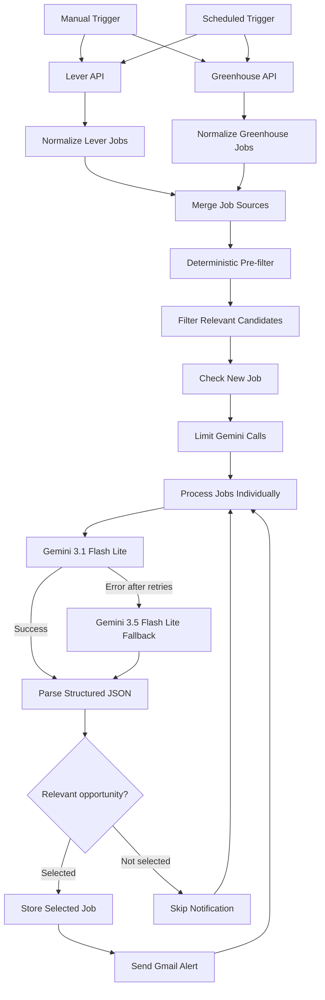

# 🤖 AI Job Hunter

> An automated, AI-powered workflow for discovering, filtering, analyzing and ranking job opportunities based on a candidate's technical profile and career goals.

AI Job Hunter is a production-deployed job discovery system built with **n8n, Gemini and Railway**.

Instead of relying only on job titles or simple keyword matching, the workflow collects opportunities from multiple ATS sources, applies a deterministic pre-filter, and uses an LLM to evaluate the actual responsibilities of each position.

The system is specifically designed to identify both explicit AI roles and **hidden AI opportunities** — positions whose titles may not mention AI, GenAI or LLMs but whose actual responsibilities involve AI agents, intelligent automation, LLM applications or AI-powered workflows.

---

## 🎯 Why I built this

Job searching in AI and automation presents two recurring problems:

1. Relevant opportunities are distributed across multiple platforms and company career pages.
2. Job titles are often misleading.

A position titled `Solutions Engineer`, `Integration Engineer`, `Backend Engineer` or `Data Engineer` may involve substantial AI engineering responsibilities, while another position may repeatedly mention AI in the company description without actually involving AI engineering.

AI Job Hunter addresses this by analyzing the **actual job responsibilities and requirements**, rather than relying exclusively on titles or keyword frequency.

The objective is to turn job discovery into a repeatable pipeline:

```text
Collect → Normalize → Pre-filter → Deduplicate → Analyze → Rank → Notify
```

---

## ✨ Current capabilities

- Multi-source job collection
- Lever ATS integration
- Greenhouse ATS integration
- Unified job schema across sources
- Deterministic relevance pre-filtering
- Geographic filtering
- Seniority filtering
- Persistent duplicate detection
- Gemini-based semantic job analysis
- Candidate/job fit scoring
- Junior compatibility scoring
- AI/automation relevance scoring
- Hidden AI role detection
- Automatic recommendation
- Gemini retry strategy
- Automatic fallback to a secondary Gemini model
- Gmail alerts for selected opportunities
- Scheduled cloud execution
- Persistent workflow deployment on Railway
- Manual execution for testing and debugging

---

## 🧠 How the system works

### 1. Job collection

The workflow currently collects job postings from two ATS platforms:

- **Lever**
- **Greenhouse**

Each source has its own collector and normalization step.

The current implementation uses company-specific public ATS endpoints as initial sources. The architecture is designed so additional companies and sources can be integrated later.

---

### 2. Normalization

Different ATS providers return different JSON structures.

Each collector therefore converts raw job postings into a common internal representation:

```json
{
  "source": "lever",
  "source_id": "job-id",
  "title": "Data Engineer",
  "company": "Company",
  "location": "Paris",
  "team": "Data",
  "contract_type": "Full-time",
  "description": "...",
  "job_url": "...",
  "apply_url": "...",
  "collected_at": "..."
}
```

This makes the rest of the pipeline independent from the original ATS format.

---

### 3. Deterministic pre-filtering

Sending every collected job directly to an LLM would be unnecessarily expensive and noisy.

A deterministic JavaScript pre-filter first evaluates signals such as:

- AI / GenAI terminology
- agentic AI
- LLMs
- RAG
- MCP
- LangGraph
- workflow automation
- machine learning
- relevant engineering titles
- Python / APIs / GCP / data engineering technologies
- geographic compatibility
- obvious seniority indicators

The filter intentionally remains permissive.

Its purpose is **not to make the final hiring decision**, but to remove clearly irrelevant opportunities before semantic analysis.

---

### 4. Persistent deduplication

Each opportunity receives a unique key:

```text
source:source_id
```

For example:

```text
lever:abc123
greenhouse:456789
```

Before sending an opportunity to Gemini, the workflow checks an n8n Data Table to determine whether the job has already been retained and stored.

This prevents selected opportunities from repeatedly generating notifications.

> **Current V1 limitation:** only retained opportunities are persisted after analysis. Rejected or review-only jobs are not yet permanently marked as analyzed. Persistent tracking of every analyzed job is planned for the next version.

---

## 🧠 Gemini semantic analysis

Jobs that survive the deterministic filtering stage are analyzed individually by Gemini.

The LLM is instructed to distinguish between:

### Job-level evidence

Actual technologies, requirements and responsibilities associated with the position.

### Company-level marketing

Statements such as:

```text
"We are an AI-native company"
"We use generative AI"
"We are transforming our business with AI"
```

These statements do **not** automatically make a position an AI engineering role.

The classifier is explicitly instructed to evaluate what the person hired for the position will actually do.

---

## 📊 Scoring system

Gemini evaluates each opportunity across several independent dimensions.

### AI Automation Relevance

```text
0 ─────────────────────────────── 100
Unrelated                   Core AI role
```

Measures how strongly the actual responsibilities involve:

- LLM applications
- AI agents
- agentic workflows
- GenAI systems
- RAG
- intelligent automation
- AI integrations
- AI orchestration
- AI application engineering

---

### Junior Compatibility

Measures how realistically accessible the position is to an early-career candidate.

The model distinguishes between:

- mandatory experience
- preferred experience
- nice-to-have requirements
- clearly senior expectations

Internships, projects and first professional experiences are considered relevant junior experience.

---

### Candidate Fit

Measures how closely the candidate's **demonstrated skills** match the actual requirements.

The classifier is deliberately conservative.

For example:

```text
Docker ≠ Kubernetes
GCP ≠ AWS
LangGraph ≠ LangChain
FastAPI ≠ Django
```

Transferable experience may influence the overall score but is not reported as an exact skill match.

---

## 🕵️ Hidden AI Role Detection

One of the core features of the project is the detection of **hidden AI opportunities**.

A position can be classified as:

```json
{
  "hidden_ai_automation_role": true
}
```

only when:

1. its title does not explicitly advertise an AI/ML/GenAI/automation role;
2. its actual responsibilities substantially involve AI agents, LLM applications, RAG, intelligent workflows or AI-powered automation.

Example:

```text
Solutions Engineer
        ↓
Build LLM integrations
Deploy AI-powered workflows
Integrate AI agents with customer systems
        ↓
Hidden AI role = TRUE
```

Whereas:

```text
Data Engineer
        ↓
Build ETL pipelines
Maintain data models
Prepare data for future AI use cases
        ↓
Hidden AI role = FALSE
```

This distinction helps discover relevant positions that conventional title-based searches may miss.

---

## 🎯 Recommendation engine

After analysis, each opportunity receives one of four recommendations:

| Recommendation | Meaning |
|---|---|
| `PRIORITY` | Strong AI/automation relevance, strong fit and realistic seniority |
| `APPLY` | Relevant or strategically adjacent opportunity worth applying to |
| `REVIEW` | Ambiguous opportunity requiring human judgment |
| `SKIP` | Insufficient relevance, excessive seniority or weak candidate fit |

The recommendation is based on multiple dimensions rather than a single score.

---

## 🔀 Decision routing

The production workflow currently routes an opportunity toward notification when:

```text
Recommendation = PRIORITY
        OR
Recommendation = APPLY
        OR
Hidden AI Role = true
```

and:

```text
Junior Compatibility >= 40
```

Selected jobs are persisted and trigger an email notification.

Rejected jobs return to the processing loop without generating an alert.

---

## 📧 Job alerts

Selected opportunities generate a Gmail notification containing:

- job title
- company
- location
- contract type
- recommendation
- AI/automation relevance
- junior compatibility
- candidate fit
- hidden AI role status
- experience requirement
- reasoning
- matching skills
- missing skills
- job URL
- application URL

This means the system does not simply say:

> "New job found."

It provides a compact AI-generated assessment that helps decide whether the opportunity deserves immediate attention.

---

## 🛡️ LLM resilience

External LLM APIs can temporarily fail because of:

- rate limits
- service saturation
- transient provider errors
- temporary model unavailability

The production workflow therefore implements retry and fallback logic.

```text
                 ┌───────────────────────┐
                 │ Gemini 3.1 Flash Lite │
                 └───────────┬───────────┘
                             │
                    success  │  error
                      ┌──────┴──────┐
                      │             │
                      ▼             ▼
                   Parse      Retry / fallback
                                    │
                                    ▼
                         ┌───────────────────────┐
                         │ Gemini 3.5 Flash Lite │
                         └───────────┬───────────┘
                                     │
                                     ▼
                                   Parse
```

The primary model uses automatic retries before the workflow follows the error branch.

The fallback path is configured as a resilience mechanism. It is not presented as a guarantee against every possible provider failure.

---

## 🏗️ Architecture



---

## 🧰 Tech stack

| Layer | Technology |
|---|---|
| Workflow orchestration | n8n |
| AI analysis | Google Gemini |
| Workflow logic | JavaScript |
| Job sources | Lever API, Greenhouse API |
| Persistence | n8n Data Tables / PostgreSQL-backed deployment |
| Notifications | Gmail OAuth |
| Deployment | Railway |
| Containerization | Docker |
| Version control | Git / GitHub |

---

## ☁️ Deployment

The workflow is deployed as a persistent n8n instance on **Railway**.

The cloud deployment includes:

```text
Railway
│
├── n8n
│   ├── Workflow execution
│   ├── Scheduled trigger
│   ├── Gemini integration
│   └── Gmail integration
│
└── PostgreSQL
    └── Persistent n8n data
```

The workflow timezone is explicitly configured as:

```text
Europe/Paris
```

The production V1 schedule runs automatically at:

```text
08:00 Europe/Paris
```

A manual trigger remains available for testing and debugging.

---

## 🔐 Security

Secrets are **not stored in the repository**.

Sensitive information such as:

- Gemini API keys
- Gmail OAuth tokens
- OAuth client secrets
- database credentials

is managed through n8n credentials or deployment environment configuration.

The exported workflow contains credential references required by n8n, but not the underlying secret values.

---

## ⚙️ Running locally

### Requirements

- Docker
- Docker Compose

Clone the repository:

```bash
git clone <repository-url>
cd ai-job-hunter-agent
```

Start n8n:

```bash
docker compose up -d
```

Then open:

```text
http://localhost:5678
```

Import the production workflow from:

```text
workflows/ai-job-hunter-production.json
```

You will need to configure your own:

- Gemini API credential
- Gmail OAuth credential
- n8n Data Table
- job sources

before running the complete workflow.

---

## 📁 Repository structure

```text
ai-job-hunter-agent/
│
├── workflows/
│   ├── v1-lever-collector.json
│   └── ai-job-hunter-production.json
│
├── src/
│   └── normalize_lever_jobs.js
│
├── docker-compose.yml
├── README.md
└── .gitignore
```

---

## ⚠️ Current V1 limitations

The first production version deliberately prioritizes reliability and controlled API usage over maximum throughput.

Current limitations include:

- Gemini analysis is capped at **10 jobs per workflow execution**
- only retained jobs are currently persisted after semantic analysis
- rejected jobs can therefore be analyzed again in a later execution
- ATS collectors currently target a limited number of companies
- source-specific company information is configured directly in each collector
- the workflow does not automatically generate or submit applications
- job application decisions remain human-controlled
- fallback configuration exists, but the fallback path has not yet been validated through a production failure during a successful end-to-end run

These limitations define the next engineering iterations.

---

## 🗺️ Roadmap

### V1.1 — Analysis tracking & faster discovery

- Persist every Gemini-analyzed opportunity
- Prevent `SKIP` and `REVIEW` jobs from consuming repeated LLM calls
- Process the backlog across multiple executions
- Run discovery several times per day
- Improve control over API quota consumption

Planned schedule:

```text
07:00
10:00
13:00
Europe/Paris
```

### V1.2 — Source expansion

- Add more Lever companies
- Add more Greenhouse companies
- Introduce additional ATS providers
- Improve source configuration
- Improve job description normalization

### V2 — Analytics & observability

- Analysis history
- Job discovery metrics
- Recommendation distribution
- Source performance
- AI relevance distribution
- Processing statistics
- Dashboard / monitoring layer

### Future

Potential future extensions include:

- application tracking
- CV-to-job matching
- job-specific CV recommendations
- personalized application assistance
- additional notification channels

---

## 🧪 Production status

**Current release:** `v1.0.0`

```text
Multi-source collection       ✅
Job normalization             ✅
Deterministic pre-filter      ✅
Persistent selected-job dedup ✅
Gemini semantic analysis      ✅
Candidate-fit scoring         ✅
Hidden AI role detection      ✅
Recommendation routing        ✅
Gemini retries                ✅
Gemini fallback configured    ✅
Gmail alerts                  ✅
Railway deployment            ✅
Scheduled execution           ✅
Git versioning                ✅
```

---

## 👤 Author

**Elie Gislain Sanon**

Data & AI Engineer focused on Data Engineering, GenAI, agentic systems and AI-powered automation.

Core technologies used across my projects include Python, SQL, GCP, LangGraph, MCP, Gemini / Vertex AI, FastAPI, Docker and modern data engineering tools.

---

## 📄 License

This project is released under the MIT License.